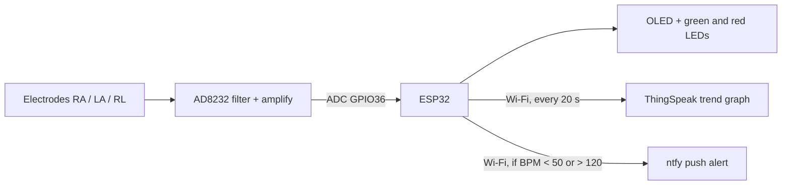

# IoT Telehealth and Remote ECG Monitor

A low-cost, battery-powered ECG monitor built on an **ESP32** and an **AD8232** sensor. It calculates heart rate (BPM) from a single-lead ECG, shows it on an OLED, logs a rolling-average BPM to **ThingSpeak** every 20 seconds for trend viewing, and sends push alerts through **ntfy** when the heart rate falls below 50 or rises above 120 BPM.

> **Disclaimer:** This is a student prototype, not a medical device. It is not clinically validated and must not be used for diagnosis or treatment.

<!-- Add a photo of the assembled device here once uploaded:

-->

## Why this project

Hospital ECG monitors are bulky, expensive and need trained staff, so people with heart conditions, elderly people living alone and people in remote areas often have no way to keep an eye on their heart at home. This project explores a small, affordable device that measures heart rate, logs it remotely and alerts the right people when it leaves a safe range.

Project Work-1, B.E. Electronics and Communication Engineering, MVSR Engineering College (2026-27).

## Features

- **Single-lead ECG acquisition** with an AD8232 and a 3-lead cable (RA, LA, RL electrodes)
- **R-peak detection on the ESP32**, sampling at **100 Hz**, with **BPM = 60000 / Δt** (Δt = milliseconds between successive R-peaks)
- **Leads-off detection**, so a loose electrode doesn't produce false readings or false alerts
- **Local display:** 0.96″ I²C OLED showing live BPM and status, a green LED that blinks on every beat and a red alert LED. These work even without internet.
- **Cloud trend logging:** rolling-average BPM uploaded to **ThingSpeak** every 20 seconds
- **Push alerts:** an HTTP request to a private **ntfy** topic when BPM < 50 or > 120, so anyone subscribed on their phone is notified. No GSM module or paid SMS account is needed.
- **Battery powered:** 4×AA pack (6 V) feeding the ESP32 VIN pin through a switch

## How it works

1. **Signal acquisition:** the electrodes pick up cardiac bio-potentials and the AD8232 filters and amplifies the microvolt-level signal.
2. **Edge processing:** the ESP32 samples the AD8232 output at 100 Hz, detects R-peaks and calculates BPM.
3. **Local visualization:** the OLED shows the BPM and lead status, and the green LED blinks with each beat.
4. **Cloud logging:** a rolling-average BPM is uploaded to ThingSpeak every 20 seconds, giving a trend graph that can be viewed remotely.
5. **Alerts:** if BPM is below 50 or above 120, the red LED turns on and the ESP32 sends an HTTP request to the ntfy topic.

### Firmware algorithm

1. Initialise the OLED, Wi-Fi, ADC and GPIO pins.
2. Read the leads-off pins. If an electrode is disconnected, show a leads-off message and restart the loop.
3. Sample the ECG signal from GPIO36 at 100 Hz.
4. Detect an R-peak when the signal crosses a threshold and reaches a local maximum.
5. Compute Δt between consecutive peaks and BPM = 60000 / Δt.
6. Update the OLED and blink the green LED on each beat.
7. Every 20 seconds, compute the rolling average BPM and upload it to ThingSpeak.
8. If BPM < 50 or > 120, switch on the red LED and send an alert to ntfy. Otherwise keep the red LED off.

The R-peak detection follows the same basic idea as the Pan–Tompkins algorithm, in a simplified, threshold-based form that suits a microcontroller.

## Hardware

| Component | Purpose |
|---|---|
| ESP32 development board | ADC sampling, R-peak detection, Wi-Fi |
| AD8232 ECG sensor kit with 3-lead cable and gel electrodes | ECG amplification, filtering and leads-off detection |
| 0.96″ I²C OLED (SSD1306) | BPM and lead status |
| Red and green 5 mm LEDs | Red = alert, green = heartbeat |
| 4×1.5 V AA battery pack with SPST switch | Portable 6 V supply to VIN |
| Breadboard, jumper wires, 100 Ω and 220 Ω resistors | Assembly |

### Wiring

**AD8232 to ESP32**

| AD8232 pin | ESP32 pin |
|---|---|
| 3.3V | 3V3 |
| GND | GND |
| OUTPUT | GPIO36 (ADC), through a 100 Ω resistor |
| LO− | GPIO26 |
| LO+ | GPIO4 |

**OLED (SSD1306, I²C) to ESP32**

| OLED pin | ESP32 pin |
|---|---|
| VCC | 3V3 |
| GND | GND |
| SCL | GPIO22 |
| SDA | GPIO21 |

**LEDs:** green on GPIO23 and red on GPIO19, each through a 220 Ω resistor to ground.

**Power:** battery positive → SPST switch → ESP32 VIN; battery negative → GND. The ESP32's 3.3 V pin powers the AD8232 and the OLED. All grounds are common.

<!-- Add the circuit diagram:

-->

### Design notes

- Four AA cells are used because three drop too low as the batteries drain.
- LO− is on GPIO26 because GPIO2 is a boot pin.
- **Safety:** the device runs on battery only while the electrodes are on a person. Don't connect it to USB or mains power while the electrodes are attached.

## Software

- **Arduino IDE** with the ESP32 board package
- **Libraries:** Adafruit SSD1306, Adafruit GFX, WiFi, HTTPClient
- **Cloud:** ThingSpeak (trend logging) and ntfy.sh (push notifications)
- **Dashboard:** <!-- add a line here if you display the ThingSpeak data on your own web page, e.g. built with Lovable, with the link -->

## Getting started

> The paths below are examples. Change them to match your repository.

1. Clone the repository: `git clone <your-repo-url>`
2. Copy `secrets_example.h` to `secrets.h` and fill in your Wi-Fi name, password, ThingSpeak API key and ntfy topic. **Never commit `secrets.h`.** Add it to `.gitignore`.
3. Open the sketch in the Arduino IDE, select your ESP32 board and upload.
4. Install the ntfy app on your phone and subscribe to your topic.
5. Attach the electrodes (RA, LA, RL), then power the device from the battery pack.

## Results

The prototype was assembled on a breadboard and tested with volunteers using gel electrodes on the right arm, left arm and right leg.

- The device powered up from the 4×AA pack, and the AD8232 and OLED ran from the ESP32's 3.3 V supply.
- The OLED showed live BPM and Wi-Fi status, and the green LED blinked with each detected beat.
- Removing an electrode triggered the leads-off message.
- ThingSpeak received the rolling-average BPM every 20 seconds and produced a graph viewable remotely.
- With thresholds at 50 and 120 BPM, the red LED turned on when the heart rate was out of range and a push notification arrived through ntfy.

**Heart-rate accuracy** (compared with a pulse oximeter):

| Trial | Device BPM | Reference BPM | Difference |
|---|---|---|---|
| 1 | 101 | 106 | 5 BPM |

<!-- Add more trials here before publishing, plus:
- Longest continuous logging test: X hours
- Time from out-of-range event to phone notification: about X seconds
- Practical observations: motion noise, electrode placement, Wi-Fi delay, battery life
-->

<!-- Add screenshots:

-->

## Limitations

- Single lead and heart rate only, so it can't diagnose specific conditions.
- Needs Wi-Fi and internet for cloud logging and alerts. Unlike SMS, ntfy notifications won't reach a phone without a data connection.
- Anyone who knows the topic name can read it on the public ntfy server. A long, hard-to-guess topic is used, but a self-hosted or access-controlled ntfy server would be needed for real patients.
- Motion artefacts can affect readings.
- Only the rolling-average BPM goes to the cloud, not the raw ECG waveform.
- Prototype only, not a certified medical device.

## Future work

- Mobile app and more advanced ECG analysis
- AI/ML-based abnormality detection
- Secure alert channel (self-hosted ntfy or access control) and an SMS fallback for weak-internet areas
- Extra sensors such as SpO₂ and temperature
- Integration with a telemedicine platform

## Team

- Samridhi Narwade
- Pulijala Archana

Guide: C. Laxmana Sai, Assistant Professor, Department of ECE, MVSR Engineering College

<!-- Add your LinkedIn and email here -->

## References

- J. Pan and W. J. Tompkins, "A Real-Time QRS Detection Algorithm," *IEEE Trans. Biomed. Eng.*, vol. BME-32, no. 3, pp. 230–236, 1985.
- Analog Devices, *AD8232 Single-Lead, Heart Rate Monitor Front End* datasheet.
- Espressif Systems, *ESP32 Series Datasheet*.
- ThingSpeak and ntfy documentation (docs.ntfy.sh).
