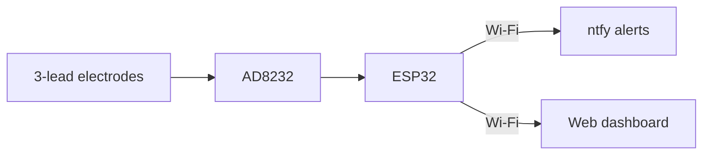

# IoT Telehealth and Remote ECG Monitor

A low-cost, portable ECG monitor built on an ESP32 and an AD8232 sensor. It measures heart rate (BPM), sends push alerts to a caregiver's phone, and shows 24-hour heart-rate trends on a web dashboard.

> **Disclaimer:** This is a student learning project, not a medical device. It is not clinically validated and must not be used for diagnosis or treatment.

<!-- Add a photo of the working device and a screenshot of the dashboard and an alert -->

## Features

- Reads an ECG signal using an **AD8232** sensor with **3-lead biomedical cables**
- Calculates **heart rate (BPM)** on the **ESP32**
- Sends **push notifications through [ntfy](https://ntfy.sh)** when the monitor detects BPM outside the range of 50-120 BPM.
- Shows **24-hour heart-rate tracking** on a web dashboard built with **Lovable**, so trends are easy to spot

## How it works

1. The electrodes pick up the heart's electrical signal, and the AD8232 amplifies and filters it.
2. The ESP32 reads the signal on **GPIO36** at **[sampling rate]** and detects heartbeats by **[your method, e.g. peak detection with a threshold]**.
3. BPM is calculated from the time between beats, averaged over **[N beats / N seconds]**.
4. If BPM leaves the safe range **[X–Y]**, the ESP32 sends a push notification through ntfy.
5. Readings are sent to **[how: HTTP request / database / API]** and shown on the dashboard.

## Hardware

| Component | Purpose |
|---|---|
| ESP32 Devkit | Microcontroller with Wi-Fi |
| AD8232 ECG sensor module | ECG signal amplification and filtering |
| 3-lead biomedical cable and electrodes | Signal pickup |
| Power: 4 x 1.5V AA Battery-pack | Power supply |

<!-- Add a wiring diagram or photo -->

## Software

- **Firmware:** Arduino IDE, written in C.
- **Notifications:** ntfy
- **Dashboard:** built with Lovable
- **Libraries:** WiFi.h, HTTPClient.h, WiFiClientSecure.h, Adafruit_SSD1306.h, Adafruit_GFX.h

## Setup

1. Clone the repository: `git clone [(https://github.com/samridhi-narwade/iot-telehealth-ecg-monitor)]`
2. Copy `secrets_example.h` to `secrets.h` and enter your Wi-Fi name, password and ntfy topic.
3. Open the sketch in Arduino IDE, select your ESP32 board and upload.
4. Subscribe to your ntfy topic in the ntfy app on your phone.
5. Attach the electrodes as shown in circuitdiagram.png , and power the device.

## Results

- [Tested for X hours/days with Y outcome]
- [Compared BPM with a pulse oximeter or smartwatch: within about X BPM]
- [Alert delay: about X seconds from event to notification]

## Limitations

- Not clinically validated, so accuracy is limited to my own comparison tests.
- Readings can be noisy if electrodes are loose or the person moves.
- [Anything else you noticed, e.g. Wi-Fi drops or battery life]

## Future work

- [Example: store data locally during Wi-Fi outages]
- [Example: improve noise filtering]
- [Example: battery power and a case]

## Author

Samridhi Narwade — [LinkedIn link] · [email]
